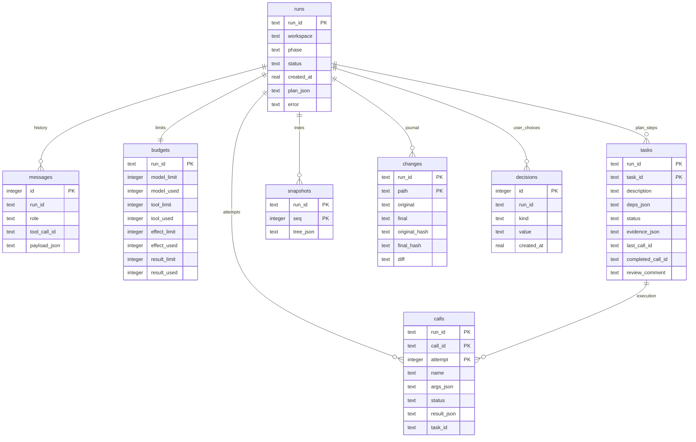

# General Purpose Agent

This repository contains a small OpenAI-compatible coding agent. The model decides when to answer directly and when to call a registered workspace tool. Runtime state, tool attempts, budgets, tasks, snapshots, changes, and chat history are stored in SQLite.

## Setup

```bash
python3 -m pip install -r requirements-dev.txt
cp .env.example .env
```

Configure the provider in `.env`:

```text
OPENAI_API_KEY=your-key
OPENAI_BASE_URL=http://localhost:11434/v1/
OPENAI_MODEL=qwen3:4b
```

The default example targets a local Ollama-compatible endpoint. The adapter targets Chat Completions with native tool calling; verify the selected provider with your model. Optional reasoning fields are sent only when explicitly configured.

## Run

```bash
python3 -m agent --workspace workspace
```

The interactive CLI uses `prompt-toolkit` for Unicode-aware editing, including Cyrillic input and backspace. Normal conversation is answered directly; coding and workspace work uses tools selected by the model.

Available tools are `list_files`, `read_file`, `write_file`, `delete_file`, and restricted `bash`. Paths are resolved inside the workspace. Bash rejects shell features that could bypass the change journal, such as pipes, redirects, command substitution, and source-changing commands.

For environment diagnostics, Bash accepts `python3 --version`, `python3 -V`
(and the same forms with `python`), `pwd`, and `ls` with `-a`, `-l`, `-la`,
`-al`, `-h`, `-lah`, or `-alh`. Prefer `python3`: `python` may not be installed.
Version commands accept no extra arguments. `unittest --version` is not supported;
unittest is part of the Python standard library, so check the Python version.
Submit each command as a separate tool call; `&&` remains forbidden. These Bash
diagnostics, like other Bash commands, are blocked until plan approval.

## Chat commands

```text
/new                              start a new chat
/chats                            list saved chats and their first request
/resume [run_id]                  show and continue a saved chat
/approve                          approve a saved plan
/reject                           reject a saved plan
/status                           show the current run
/budget                           show remaining budgets
/tasks                            show the task checklist
/diff                             show changes for the current run
/rollback                         restore the current run when no conflict exists
/resolve <call_id> retry|fail|abort resolve an unknown call manually
/exit                             leave the CLI
```

When `/resume` finds a tool call that was interrupted before its result was saved, it shows the call and asks whether to retry, fail, or abort. The manual `/resolve` command expects a `call_id`, not a `run_id`.

## Plans and task review

Start Plan Mode with:

```bash
python3 -m agent --plan --workspace workspace
```

Before approval, only read-only tools are allowed. After approval, plan steps become dependent tasks. A successful tool call produces a candidate result; the CLI shows the tool, arguments, and shortened result and asks whether the result is acceptable. Approval marks the task as `done`. Rejection records the user's comment and sends the task back to the model.

## Budgets

Limits are configured in `agent.toml` and apply to the complete `run_id`, including planning, approval, resume, and retry:

```toml
[limits]
model = 20
tools = 40
effects = 15
result = 120000
```

`model` counts model requests, `tools` counts tool calls, `effects` counts potentially changing actions, and `result` limits the total size of tool results in bytes. Multi-call batches reserve their complete tool and effect budget before any call starts. Progress events show the remaining counters.

## Change journal and rollback

Before a changing action, runtime compares the workspace with the latest snapshot. After the action it records original and final states, hashes, and a unified diff in SQLite. `/diff` shows the current run's journal.

`/rollback` checks every final hash before writing anything. If a file changed outside the run, rollback is blocked and reports the expected and current hash. If all hashes match, only files changed by the current run are restored. Unrelated files are left untouched.

## Verification

```bash
python3 -m unittest discover -v
python3 -m ruff check agent tests
```

## Runtime internals

The application has five layers:

| Module | Responsibility |
|---|---|
| `agent/client.py` | Builds Chat Completions requests and parses assistant text/tool calls. It has no workspace executors. |
| `agent/runtime.py` | Drives the loop, phase transitions, task review, budgets and recovery. |
| `agent/tools.py` | Validates schemas and workspace paths, executes tools, captures snapshots and diffs. |
| `agent/storage.py` | SQLite persistence; explicit `BEGIN IMMEDIATE` transactions for budget reservation. |
| `agent/__main__.py` | Interactive commands, progress display and user decisions. |

A run stores a canonical absolute workspace path. Opening its state with a different workspace is rejected. A new user message normally continues the same run and retains its budget. A planning run requires explicit approval before ordinary execution.

The execution loop is:

1. Reserve one model request, then send persisted messages and tool definitions.
2. Save the assistant response. A text response ends ordinary execution; planning responses are parsed into a saved plan.
3. For a tool batch, check call identities and task dependencies. Atomically check and reserve the entire tool/effect budget and insert started attempts.
4. For each call, validate arguments and phase restrictions. Check available result space before starting execution. A successful cached call returns its saved result.
5. Before a changing tool, compare the tree with the latest snapshot. Run the executor, capture changes and serialize a bounded result. Complete the same attempt that was started; explicit retry creates another attempt.
6. Save a tool message with the original call ID and return it to the model. A task candidate is offered for review in the CLI.

The model selects operations; it never directly owns the database connection or filesystem access. This is a synchronous, sequential runtime, not a parallel task scheduler.

## SQLite data model

The default file is `.agent/state.sqlite3`, using WAL. JSON fields retain structured provider messages, plans, dependencies and snapshots. The diagram describes logical relationships; not every relationship is enforced by a database foreign key.



`calls` identifies an attempt by `(run_id, call_id, attempt)`. A retry preserves name and arguments. Budget reservations use an explicit transaction: a failed insertion rolls back all reservations in that transaction. Committed reservations remain spent after an execution failure.

`snapshots` stores successive trees. `changes` keeps the first original and latest final state for each path; its unified diff is computed between these endpoints. New regular-file snapshots encode exact bytes as Base64 with a version prefix, preserving binary content and CRLF. Symlinks use a separate textual representation. Legacy binary snapshots contained only hashes and cannot be restored.

Rollback checks all recorded final hashes and path types before writing. Unresolved attempts block it. On completion it records a decision and sets the run to `rolled_back`; create a new run for further work. Filesystem writes and SQLite commits are not a single atomic transaction.

## Execution boundaries and remaining limitations

Use Python 3.9+ and a POSIX environment with `/bin/bash` (WSL on Windows). Bash receives a quoted, validated argv through an explicit Bash process. Output is capped and marked truncated. Tests execute with the operating-system privileges of the agent: the allowlist is not a sandbox for untrusted Python code.

Journal exclusions are `.git` and the exact configured SQLite state file with its WAL/SHM companions. User `.db` files and nested `.agent` project data are journaled. Keep runtime state in the default `.agent` directory.

The original findings remain in `REVIEW.md` as a historical audit. Follow-up requests create new tasks without reopening completed tasks. The model receives phase-specific system instructions; execution never inherits the planner prompt. Text pretending to be a tool call is returned for correction, never executed. Python writes are syntax-checked before touching the file. Python changes require a subsequent successful unittest/pytest command before the run can complete.

Without a review callback the runtime persists `waiting_review`; it never invents user approval. Reopen the run through the CLI to review the result. Plans require goal, readiness criteria, risks, assumptions and described steps; reject dependency cycles and embedded tool arguments; steps list tool names. The runtime preserves insertion order among ready tasks.

Recovery reconstructs missing tool messages from stored results. Unknown calls remain blocked across repeated resume. If the tree changed since the last snapshot, the CLI asks whether those changes belong to the run before resolving the call. The core API exposes this explicitly as `resolve(call_id, action, accept_changes=True)`. Bash retry is refused because tests can have arbitrary side effects; use fail or abort. File writes/deletes can be retried only after tree reconciliation. Unknown changes and results must be reviewed in a trusted, non-concurrently-edited workspace.

Remaining technical limits: filesystem effects and SQLite cannot commit atomically; process termination during rollback itself is not recovered transactionally; file permission bits are not preserved. The core still emits some formatted progress strings. Native tool-calling behavior must be tested against the selected real model. These are not covered by a claim of full production reliability.

Provider compatibility is tested locally with a fake adapter; optional provider fields may require adjustment. The default example is Ollama on localhost. A real-model acceptance run is still required for the selected provider.

## GPT-6 Luna with Chat Completions

Use `OPENAI_MODEL=gpt-6-luna` and `OPENAI_REASONING_EFFORT=none`.
For Luna tool requests the adapter explicitly sends `reasoning_effort: "none"`;
omitting the field would select the model default. Non-`none` settings are rejected
locally with a configuration error instead of sending an unsupported request.
Reasoning together with tools requires Responses API, which this adapter does not
currently implement. See the [official Luna documentation](https://developers.openai.com/api/docs/models/gpt-6-luna).
Environment variables take precedence over `.env`; unset or update an exported
`OPENAI_REASONING_EFFORT` if it overrides the file.


For test execution, prefer the registered `run_tests` tool over Bash. Pass `runner` as `pytest` or `unittest`, plus an optional workspace-relative test path and cwd. It invokes `python3 -m <runner>` directly, captures bounded output, and returns the test process exit code; a failing test suite is still a successfully executed diagnostic tool call. `unittest` with path `discover` runs discovery from the selected cwd.
